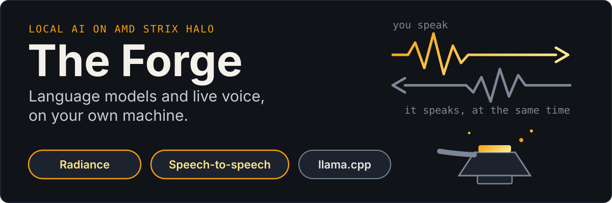
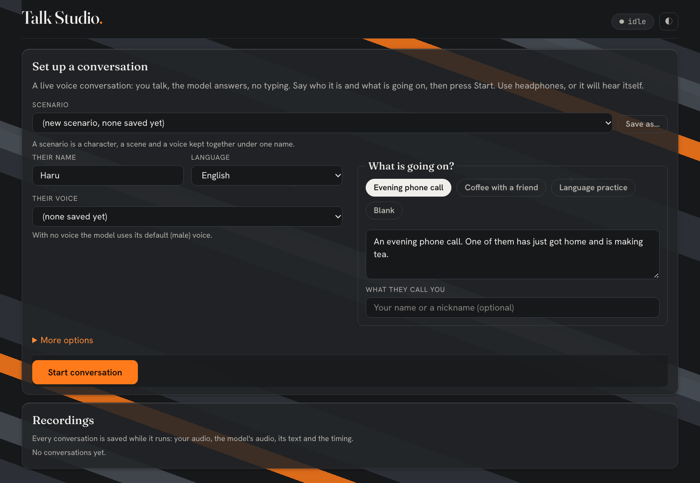
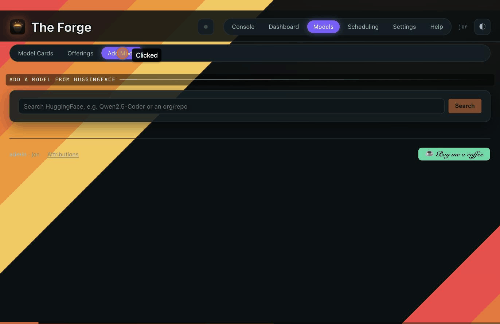
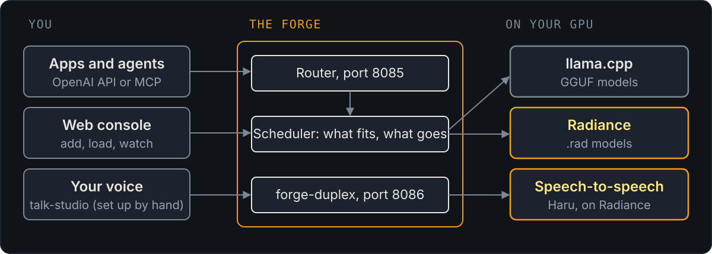

<div align="center">



[](LICENSE)


[](https://buymeacoffee.com/jsaigou)

**[Radiance](#radiance)** · **[Speech-to-speech](#speech-to-speech)** · **[Everything else](#everything-else)** · **[Install](#install)** · **[Docs](#documentation)**

</div>

The Forge turns one machine into a private AI server. You choose models in a web page; it loads them into GPU memory when they are needed,
makes room when memory runs short, and serves them to your apps through one OpenAI-compatible address.

It is built for AMD Strix Halo machines, where the CPU and GPU share one large pool of memory.

## Radiance

Run [Radiance](https://codeberg.org/StillDeadcode/radiance) models next to llama.cpp, in the same console and behind the same API.

Radiance runs `.rad` files, which can keep different parts of a model at different precisions. On Strix Halo the installer builds our
[unofficial fork](https://github.com/jsaigou/radiance-strix) of the engine and adds it to the catalog, and ready-made models are on Hugging Face:

| Model | File | Memory in use | Measured speed |
|---|---:|---|---|
| [Qwen3.8-Flash-Next](https://huggingface.co/jsaigou/Qwen3.8-Flash-Next-UD-Size-radiance) | 84 GiB | about 93 GiB | 91 tokens/s across 3 requests |
| [Qwen3.6-35B-A3B](https://huggingface.co/jsaigou/Qwen3.6-35B-A3B-W4W5-RTN-radiance) | 21 GiB | about 34 GiB | 64 tokens/s, one request (early test) |

<sub>Measured by us on one Ryzen AI Max+ 395 with 128 GB, with the settings on each model card. Needs ROCm 10.x and `amdgpu.cwsr_enable=1`.</sub>

**[Set up Radiance →](docs/radiance.md)**

## Speech-to-speech

Talk to a model that **listens and speaks at the same time**. Interrupt it, talk over it, or let it fill a pause. This is not speech-to-text
followed by a reply: audio goes in and audio comes out, one 133 ms frame at a time.



- **talk-studio** is the page you talk in: set a character and a scene, pick a voice, and replay recorded conversations.
- **forge-duplex** carries the live audio session. Its engine protocol is not tied to one model.
- **[Haru-4B](https://huggingface.co/jsaigou/Haru-4B-bf16-radiance)** is the first model, running on Radiance. On our test machine each step takes
  68 to 78 ms (median), within the 133 ms available. We have listened to English and Japanese.

You can try the whole audio path on any computer, with no GPU, using a stand-in that echoes your voice:

```bash
git clone https://github.com/jsaigou/the-forge.git && cd the-forge/go
go run ./cmd/forge-duplex
# second terminal, same folder:
TALK_STUDIO_LISTEN=127.0.0.1:8092 TALK_STUDIO_DUPLEX_URL=http://127.0.0.1:8086 \
  go run ./cmd/talk-studio
# open http://localhost:8092 and wear headphones
```

> Speech-to-speech is early. The installer does not set it up yet; the guide takes you through it by hand.

**[Set up speech-to-speech →](docs/speech-to-speech.md)**

## Everything else

| Feature | What you get |
|---|---|
| **Load on demand** | Four model slots share the memory. A request loads its model; idle models are unloaded when space is needed. |
| **One API** | An OpenAI-compatible router (`a0`) in front of your local models and cloud providers, with failover, usage and cost tracking. |
| **Add models** | Search Hugging Face, see which files fit your memory, check, download. llama.cpp is built for you with Vulkan, and with ROCm (needed above about 63 GB) where its development files are installed. |
| **Text-to-speech** | The installer sets up preset voices. Voice cloning and voice design need engines you set up yourself. [Voice Studio](https://github.com/jsaigou/forge-voice-studio) is the app for making voices. |
| **Measure** | Profile llama.cpp models on your hardware and compare them side by side. |
| **Look after itself** | Smith, a built-in agent, runs health checks and proposes fixes you can approve. |
| **For agents** | An MCP server to load, unload and reserve models. |
| **Two languages** | Web console and command line in English and Japanese. |

<p align="center">
  
</p>

## How it fits together



## Install

**You need** Linux with systemd, at least 64 GB of memory, and an AMD GPU. Tested on one Strix Halo machine; other setups may work with
llama.cpp but are untested. Install Git, Go 1.26+, and Node.js 22+ first; the installer names anything else that is missing.

```bash
git clone https://github.com/jsaigou/the-forge.git && cd the-forge
sudo ./install.sh --target=public --dry-run    # see what it would do
sudo ./install.sh --target=public
```

| Option | Adds or changes |
|---|---|
| `--speech=kokoro` | Text-to-speech with preset voices, and Voice Studio |
| `--no-radiance` | Skips the Radiance engine |
| `--no-llama` | Skips building llama.cpp |

If ROCm is not in a standard place, add it in front: `sudo ROCM_ROOT=/path/to/rocm ./install.sh --target=public`.

Then open the web console at <http://localhost:5000> to create your account, add a model, and make an API key. Point any OpenAI-compatible app at
`http://localhost:8085/v1`.

```bash
forge status                   # slots and memory
forge models                   # what you can load
forge load <name>              # load a model
forge tui                      # full-screen terminal console
```

## Documentation

| Guide | |
|---|---|
| [Radiance](docs/radiance.md) | engine, models and settings |
| [Speech-to-speech](docs/speech-to-speech.md) | talk to a full-duplex model |
| [Adding a model](docs/adding-a-model.md) | from Hugging Face to a working config |
| [Router](docs/llm-router.md) | the API, providers and failover |
| [Scheduler](docs/scheduler.md) | slots, memory and reservations |
| [Deployment](docs/deployment.md) | services and operations |
| [Pitfalls](docs/pitfalls.md) | hardware problems worth knowing about |
| [Design records](docs/adr/) | why it works the way it does |

## Status

An early release, built and tested on one machine. Expect changes. No binaries or model weights are included: the installer builds from source,
and you download the models you choose.

## Support

If this saved you some GPU-memory headaches, [buymeacoffee.com/jsaigou](https://buymeacoffee.com/jsaigou).

## License

Apache-2.0, see [LICENSE](LICENSE). Radiance is by Deadcode (Apache-2.0). Models have their own licences.
