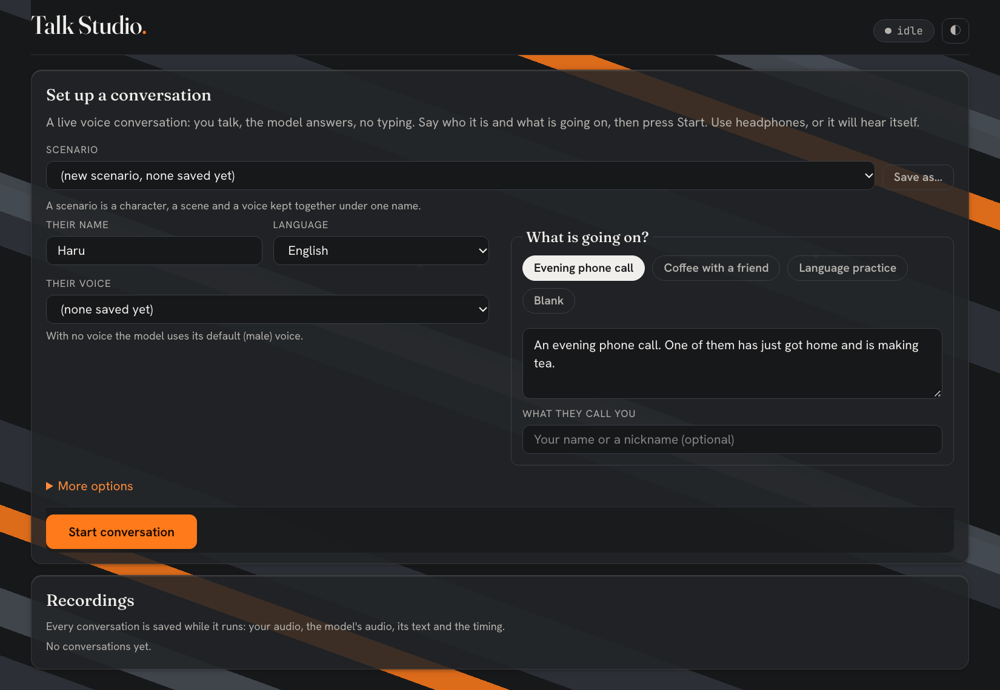

# Speech-to-speech

A full-duplex voice model listens and speaks at the same time. There is no "press to talk" and no waiting for a transcript: audio goes in and
audio comes out, one 133 ms frame at a time, so you can interrupt it and it can answer while you are still talking.

**Status: early.** It works, but `install.sh` does not set it up, and you start it by hand as below.

## The parts

| Part | What it does | Port in this guide |
|---|---|---|
| **talk-studio** | The page you talk in. Characters, voices, recordings | 8092 |
| **forge-duplex** | Carries the audio session and keeps the 133 ms clock | 8086 |
| **The engine** | The model: [Haru-4B](https://huggingface.co/higurashi-ai/Haru-4B) on Radiance | 8102 |

## Try it with no GPU (about 2 minutes)

This runs the whole path with a stand-in that echoes your voice back, one frame late. It needs only Go 1.26 or later and a browser.
**Wear headphones**, or the echo feeds back into the microphone.

```bash
git clone https://github.com/jsaigou/the-forge.git && cd the-forge/go
go run ./cmd/forge-duplex
```

In a second terminal, in the same folder:

```bash
TALK_STUDIO_LISTEN=127.0.0.1:8092 TALK_STUDIO_DUPLEX_URL=http://127.0.0.1:8086 \
  go run ./cmd/talk-studio
```

Open <http://localhost:8092> and press **Start conversation**.

`TALK_STUDIO_LISTEN` keeps the page on this machine. Without it talk-studio listens on every network interface, and it has no sign-in.
Recordings are saved in a `data` folder where you start it.

## Talk to Haru

You need the same hardware and software as for [Radiance](radiance.md#what-you-need): Strix Halo, ROCm 10.1 and `amdgpu.cwsr_enable=1`.
Run these on one machine.

### 1. Build the engine and download the model

These steps come from the [model card](https://huggingface.co/jsaigou/Haru-4B-bf16-radiance), which has the full details. The model is a
9.8 GiB download. It needs the `haru/main` branch, not the release the installer builds.

```bash
git clone --branch haru/main https://github.com/jsaigou/radiance-strix.git && cd radiance-strix
export ROCM_PATH=/path/to/rocm-10.1 PATH=$ROCM_PATH/bin:$PATH LD_LIBRARY_PATH=$ROCM_PATH/lib
cmake -S . -B build -G Ninja -DCMAKE_BUILD_TYPE=Release -DRAD_GPU_TARGETS=gfx1151 -DCMAKE_PREFIX_PATH=$ROCM_PATH
cmake --build build -j8
hf download jsaigou/Haru-4B-bf16-radiance haru-bf16.rad --local-dir .
```

### 2. Start the engine

```bash
RADIANCE_HOME=$PWD/build/radiance_home RADIANCE_KERNELS=libhalo \
  build/bin/radiance --model haru-bf16.rad --host 127.0.0.1 --port 8102 --tp 1 \
  --max-model-len 14500 --max-num-seqs 2 --num-speculative-tokens 0 \
  --duplex-max-lanes 2 --duplex-max-ctx 14500
```

### 3. Start forge-duplex, pointed at the engine

In a second terminal, in `the-forge/go`:

```bash
FORGE_DUPLEX_DRIVER=remote \
FORGE_DUPLEX_ENGINE_URL=http://127.0.0.1:8102 \
FORGE_DUPLEX_ENGINE_TENANT=haru \
FORGE_DUPLEX_CARD_RENDER=haru \
go run ./cmd/forge-duplex
```

### 4. Start talk-studio

In a third terminal, in `the-forge/go`:

```bash
TALK_STUDIO_LISTEN=127.0.0.1:8092 TALK_STUDIO_DUPLEX_URL=http://127.0.0.1:8086 \
  go run ./cmd/talk-studio
```

Open <http://localhost:8092>, choose a scenario and a language, and press **Start conversation**.



## What to expect

- **Speed:** on our test machine one model step takes 68 to 78 ms at the median, inside the 133 ms available for each frame (one conversation).
- **Languages:** we have listened to English and Japanese only.
- **Behaviour:** Haru is a research base model. It holds a natural conversation, but it is not a reliable source of facts and does not follow
  instructions like an assistant.
- **Voices:** without a reference clip it uses its default voice. It can imitate a clip you give it; only use voices you have the right to use.

## Using it from another machine

A browser allows the microphone only on `localhost` or over HTTPS. To use talk-studio from a phone or laptop, serve it over HTTPS (for example
with Tailscale), set `TALK_STUDIO_ALLOWED_ORIGINS` to its address, and give `forge-duplex` the same address in
`FORGE_DUPLEX_ALLOWED_ORIGINS`. Neither service is meant to face the public internet.

## Letting The Forge load the engine

The Forge can load a speech-to-speech engine when a conversation starts and free its memory afterwards. This needs the engine registered in the
engine pool through the API, which the web screens cannot do yet. The design is in
[ADR-0029](adr/0029-duplex-engines-load-on-demand-and-talk-studio.md).

## Adding another model

`forge-duplex` talks to engines through a small, engine-neutral protocol (see
[ADR-0028](adr/0028-duplex-audio-platform.md)), and talk-studio builds its list from a model registry. Another full-duplex model needs an engine
that speaks the protocol and a registry entry.
